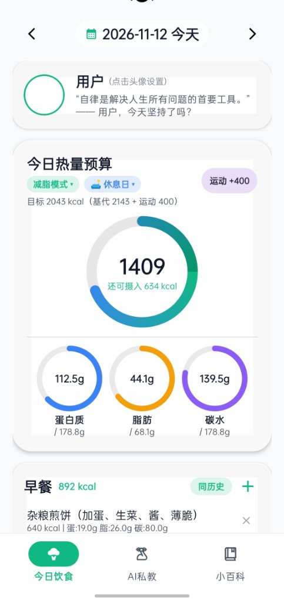
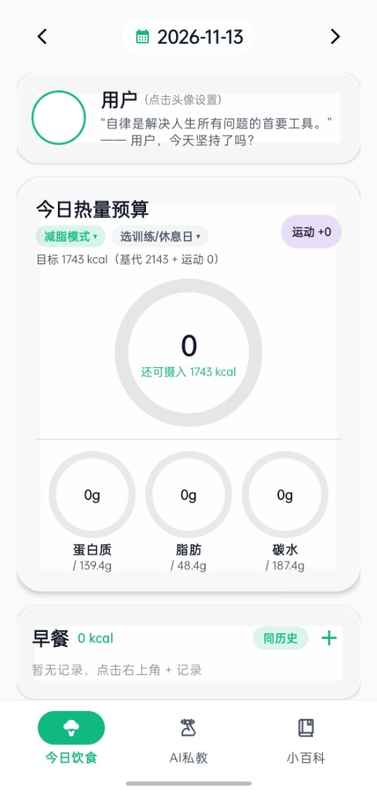
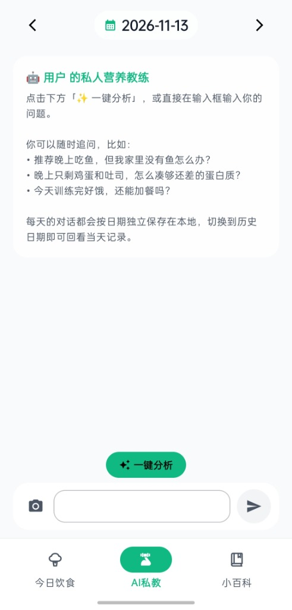
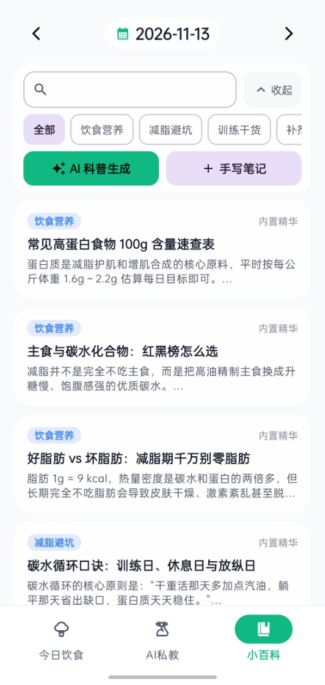

# DietTracker

一个**本地优先、无后台服务器、高度自定义**的原生 Android 饮食管理与 AI 健身记录应用（Kotlin + Jetpack Compose Material 3）。

从每日热量与碳蛋脂配比、训练日/休息日动态计划，到千焦一键换算、跨天快捷复制复吃、自定义壁纸与专属小百科——打造顺手、不上传隐私的个人健身饮食中枢。

> 📥 **直接下载安装**：前往右侧 **[Releases 页面](https://github.com/rick3059945432-eng/DietTracker/releases)** 下载最新 `DietTracker.apk` 即可在 Android 手机安装体验（最低支持 Android 8.0 / API 26）。

---

## ⚠️ 重要提示：首次使用 AI 功能请先配置 API

本软件**不包含任何内置收费账号或后台服务器**。本地饮食记录、千焦换算、历史复制与小百科查阅均可**完全离线免费使用**；如需启用 **AI 私教对话、AI 拍照/文字估算食物营养、AI 自动生成百科词条** 等能力，请按以下步骤配置你自己的接口：

1. 点击首页卡片左上角 **个人头像** 进入 **「设置」** 页面。
2. 填写兼容 OpenAI 格式的接口信息：
   - **Base URL**（默认 `https://api.openai.com/v1`，支持各类第三方中转站 / DeepSeek / 通义 / Gemini 等 OpenAI 兼容端点）
   - **API Key**（仅加密保存在你手机本地 `SharedPreferences` 中，不会上传给项目作者）
3. 点击 **「检索可用模型」** 按钮，即可直接从列表中选择你的 **对话模型** 与 **识图模型**（如 `gpt-4o-mini` / `gpt-4o` 等），保存后立刻生效。

---

## 界面预览

| 今日饮食（记录中） | 今日饮食（初始看板） | AI 私教 | 健身小百科 |
| :---: | :---: | :---: | :---: |
|  |  |  |  |

*(应用内支持深浅色模式及自由更换任意本地相册全局壁纸与透明度。)*

---

## 核心亮点与详细功能

### 一、极致的「高度自定义」体验
1. **个人信息与代谢定制**：自由设置 **昵称、头像**（自动持久化到应用私有目录）、性别、年龄、身高、体重，基于 Mifflin-St Jeor 公式实时估算 BMI、BMR 与基础维持消耗。
2. **专属全局外观**：支持 **深色 / 浅色模式** 一键切换，支持从手机相册选择 **任意图片作为全局壁纸**，并可通过滑块精细调节 **壁纸遮罩透明度**，兼顾个性展示与文字清晰度。
3. **训练节奏 & 营养模式按天定制**：
   - 支持 **健康维持 / 减脂塑形 / 健身增肌 / 自定义上限** 4 种营养模式（自定义模式可直接手填目标热量及蛋/脂/碳克数）。
   - 支持 **训练日 / 休息日 / 放纵日** 三选一日类型弹窗，依据是否训练与当天手动填写的运动消耗，动态分配碳水、蛋白质与脂肪目标。
   - **按日独立落盘**：修改今天的模式不会篡改历史日期的记录，在 **彩色饮食日历** 中可直观回看每一天的模式与日类型色彩标记。
4. **个人食物库与单位体系**：支持按 **`每 100g` / `每 100ml` / `每 1 个` / `每 1 份`** 自由录入常见食物与营养成分，也支持 **AI 拍照识别包装背面的营养成分表** 自动建库。
5. **可生长的健身小百科**：不仅内置精选词条，还支持自行新建、编辑正文、修改所属分类，随时把自己的训练心得与食谱沉淀进软件。

### 二、专为日常高频记录设计的「效率神器」
- ⚡ **千焦（kJ）一键转千卡（kcal）**：买包装食品背面只写了千焦？无需切出计算器，在**录入餐食**和**编辑常用食物**的热量输入框旁直接点击 **`kJ→kcal`** 按钮，立即按国际换算系数（`÷ 4.184`）自动四舍五入转成千卡。
- 🔁 **「同历史」跨天跨餐一键复制**：每天早餐或固定减脂餐总是那几样？点击任意餐次卡片上的历史复制入口，挑选过往任意一天的某餐即可**整餐覆盖复制到当前餐次**。
- 📋 **多处快捷复制与一键收藏**：
  - **AI 私教**每条回复下方提供独立的 **`重试`**、**`复制`** 与 **`收藏`** 小按钮，看到有用的饮食方案直接一键复制，或秒变卡片存入小百科。
  - **小百科**每篇文章详情支持一键复制全文内容。
- 📸 **AI 文字 & 识图估算**：输入“一碗牛肉面加煎蛋”或拍下食物照片，自动估算热量及三大营养素并回填表单供二次微调。

### 三、三大活页结构（底部导航栏双向联动）
1. **今日饮食**：顶部日期快捷切换 + 激励卡片 + 热量/碳蛋脂仪表盘 + 早餐/午餐/晚餐/加餐四餐记录卡片。
2. **AI 私教**：按日期隔离保存的对话历史；移除冗余顶部栏让空间更阔气；输入栏上方配有带二次确认防误触的 **`一键分析`** 与 **`清空对话`** 小胶囊；输入框采用极简无占位文字设计（左侧已预留相机传图交互入口）。
3. **小百科**：涵盖饮食营养、减脂避坑、训练干货、补剂知识、我的笔记；极简单行空白搜索框搭配右上角 **`收起 / 展开`** 按钮，收起工具栏后可大屏专心浏览条目；支持输入关键词一键 **`AI 科普生成`** 或 **`手写笔记`**。

---

## 技术栈与本地构建

- **开发语言与 UI**：Kotlin `2.0.21`、Jetpack Compose（BOM `2024.10.01`）、Material 3
- **构建环境**：Gradle `8.9`、AGP `8.7.2`、JDK 17、`minSdk 26` / `targetSdk 35`
- **网络与图片**：OkHttp `4.12.0`、Gson `2.11.0`、Coil `2.7.0`
- **本地存储**：Android 原生 SQLite（饮食记录、历史汇总、AI 对话、小百科、自定义食物）+ SharedPreferences

### 自行编译源码
```bash
git clone https://github.com/rick3059945432-eng/DietTracker.git
```
使用 **Android Studio**（建议 Ladybug 或更新版本，搭配 JDK 17）打开目录等待 Gradle 同步完成即可运行，或执行：
```bash
./gradlew assembleDebug
```
*(若你在代理环境下拉取依赖遇到超时，可参考 [gradle.properties](gradle.properties) 末尾注释配置本地代理，或在用户目录 `~/.gradle/gradle.properties` 中设置。)*

---

## 免责声明（Disclaimer）

- 本应用内置的热量/宏量估算公式、科普词条，以及由用户自行配置第三方 AI 接口生成的所有回答与食物估算数值，**仅供个人日常记录与健康科普参考，不构成医疗建议、临床营养诊断或专业诊疗意见**。
- 如有慢性疾病、代谢疾病、饮食障碍、孕产哺乳期等特殊情况，请在执行具体饮食或训练方案前咨询执业医师或注册营养师。

---

## 开源协议与致谢

- 本项目基于 [MIT License](LICENSE) 开源，欢迎 Fork、二次开发与交流学习。
- 本项目在产品构思、UI 迭代与代码编写过程中借助了 AI 辅助编程工具实现。
